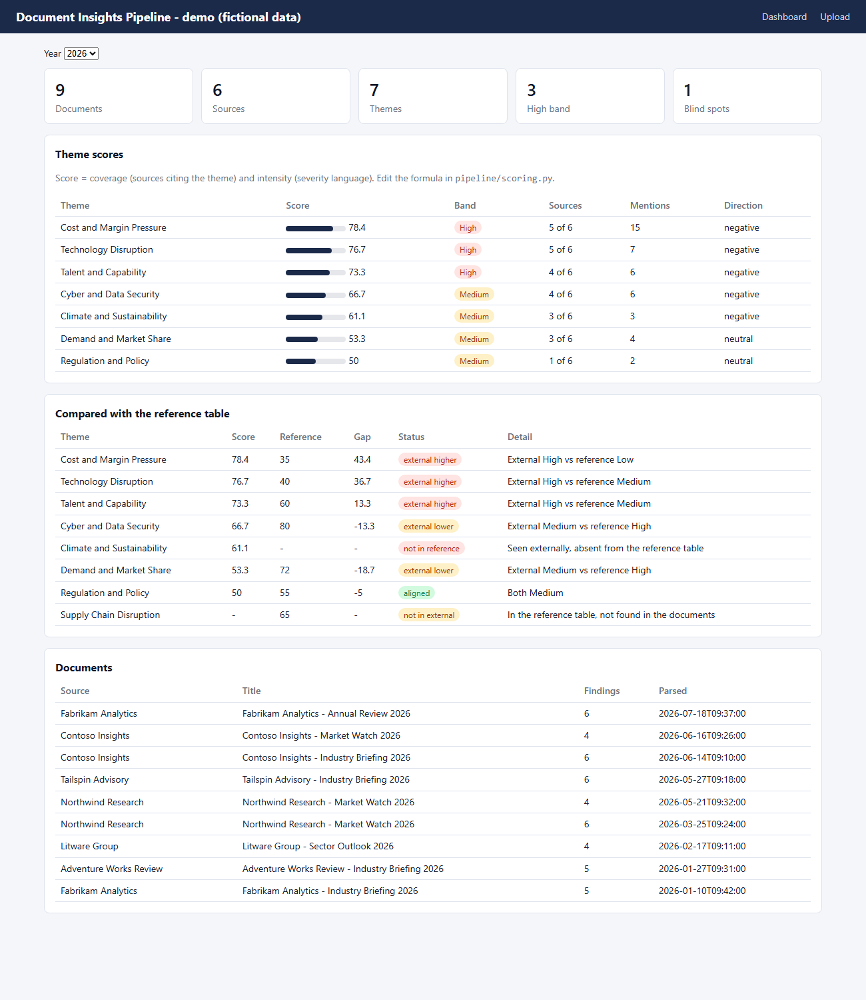

# Document Insights Pipeline

An end-to-end pattern for turning a pile of PDF reports into a scored, comparable view of the themes they raise, with a Flask dashboard on top. It is built three times, on **GCP**, **Databricks** and **Snowflake**, with the same flow and the same module names.



*The dashboard above is the real app running on invented data (see [Try it](#try-it-no-cloud-account-needed)).*

## What it does

```
PDF documents
   1 extract       an LLM reads each document and returns structured findings (theme label, direction, severity, quote, confidence)
   2 consolidate   hundreds of free-text labels are grouped into at most N canonical themes
   3 normalize     every finding is mapped to its theme; weak ones (confidence below a floor) are kept but not counted
   4 aggregate     per theme: coverage (how many sources mention it) x intensity (severity) -> score 0-100 and a band
   5 compare       scores are compared with a reference table you load (internal view, baseline, target):
                   aligned, external higher / lower, not in reference, or a blind spot (in your table, absent from the documents)
   dashboard       Flask app: scores, comparison, documents, JSON API
```

## Design choices worth a look

- **Config-driven.** Project names, buckets, tables, thresholds and weights live in `.env`; the domain lives in the prompts, `models.py` and `schemas.py`. Adapting to a new project is an edit, not a rewrite.
- **Testable core.** Consolidation, scoring and comparison are pure functions with unit tests; the flow tests run steps 2-5 against an in-memory store.
- **Idempotent.** Re-parsing a document replaces its rows; steps 2-5 rewrite one year at a time.
- **Bounded and honest.** A hard cap on theme count (with low confidence on merged themes), a confidence floor, and a spelling-based fallback when the model call fails.
- **Safe defaults.** CSRF on browser forms, machine endpoints explicitly exempt, `SECRET_KEY` mandatory in production, sanitised upload paths, no credentials in the repo.

## Repository layout

| Folder | What it is |
|---|---|
| [`demo/`](demo) | the real pipeline steps and dashboard running on fictional data, in memory |
| [`pipeline_template/`](pipeline_template) | GCP: Cloud Storage, BigQuery, Gemini, Cloud Run |
| [`pipeline_template_databricks/`](pipeline_template_databricks) | Databricks: Unity Catalog volume, Delta tables, serving endpoint, Databricks Apps |
| [`pipeline_template_snowflake/`](pipeline_template_snowflake) | Snowflake: stage, tables, Cortex, Snowpark Container Services |
| [`docs/platforms.md`](docs/platforms.md) | side-by-side comparison of the three |

Each template has its own README, `docs/ADAPTING.md`, tests, CI workflow and deploy files.

## Try it (no cloud account needed)

```powershell
python -m venv .venv
.venv\Scripts\activate
pip install -r pipeline_template/requirements.txt
python demo/run_demo.py            # open http://localhost:8080/
python -m unittest discover -s demo
```

The demo replaces only the storage layer with an in-memory store and the model call with a fixed grouping. Steps 2-5 and the dashboard are the same code as the deployed template. Six fictional sources, two years, one reference table with a deliberate blind spot (`Supply Chain Disruption`). Every name and number is invented. Uploads are disabled.

## Status

- Offline tests pass for all three templates (fake model, fake store, Flask test client) and for the demo.
- The GCP template follows the design of a pipeline that was run on real documents; the Databricks and Snowflake versions are **not verified against live services**. Their READMEs list the exact calls to check first.
- Nothing here has been security-reviewed beyond the defaults above. The apps have no login of their own; deploy them behind your platform's authentication.
